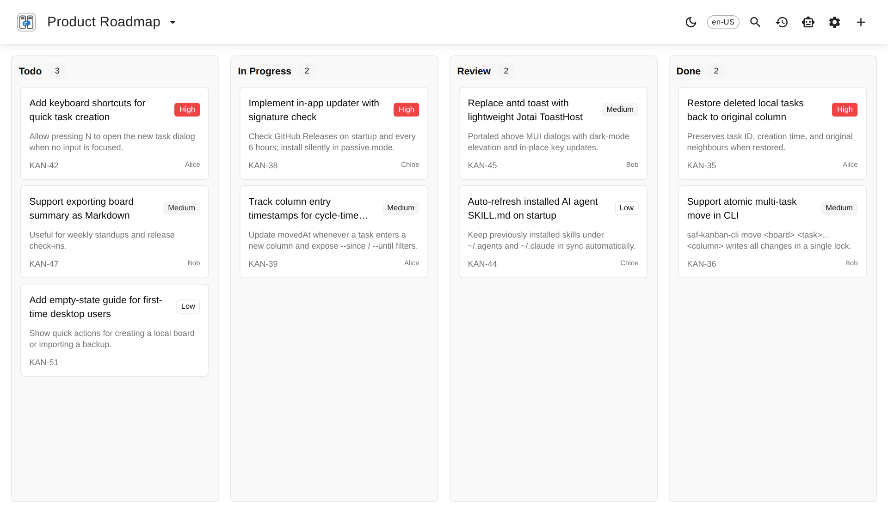

# <picture><source media="(prefers-color-scheme: dark)" srcset="design/icons/kanban-drag-frame-soft-dark.svg"></picture> SAF Kanban

[繁體中文](README.md) | English

**A personal kanban board with no backend to host — your data stays completely in your hands.**
Use it right in the browser (stored in your own Google Sheet), install the Windows desktop app (local offline files), or install the standalone CLI with one command (Windows / macOS / Linux) so AI agents can manage both local and Google Sheet boards via Skill, CLI, or MCP.

**[Open SAF Kanban](https://whlshy.github.io/SAF_Kanban/)** ｜ **[Download Desktop App & CLI](https://github.com/whlshy/SAF_Kanban/releases)** ｜ **[Changelog](CHANGELOG.en.md)**

<p align="center">
  <picture>
    <source media="(prefers-color-scheme: dark)" srcset="docs/preview-dark.png">
    
  </picture>
</p>

## Table of Contents

- [Web, Desktop App, or Standalone CLI?](#web-desktop-app-or-standalone-cli)
- [Key Features](#key-features)
- [Quick Setup (Google Sheet Web Version)](#quick-setup-google-sheet-web-version)
- [Desktop App & Standalone CLI](#desktop-app--standalone-cli)
- [More Ways to Use It](#more-ways-to-use-it)
- [Update the Apps Script](#update-the-apps-script)
- [FAQ](#faq)
- [Data and Privacy](#data-and-privacy)
- [Development](#development)

---

## Web, Desktop App, or Standalone CLI?

| | Web Version (Google Sheets) | Windows Desktop App | Standalone CLI (Windows / macOS / Linux) |
| --- | --- | --- | --- |
| Where data lives | Your own Google Sheet | Local JSON files + shared Google Sheet list | Shares the exact same local files & Google Sheet list as desktop |
| Installation | None — open in browser (optional PWA install) | Single installer (GUI + CLI), no admin rights needed | One-line command, single binary, no GUI app needed |
| Offline use | Read-only view of last loaded boards | **Full offline read & write** for local boards | **Full offline read & write** for local boards (Sheets require network) |
| AI agent integration | Pair with standalone CLI (needs Apps Script v5+) | Claude Code, Codex, Cursor, Antigravity, etc. (Skill / CLI / MCP / HTTP API) | Claude Code, Codex, Cursor, Antigravity, etc. (Skill / CLI) |
| Deleted task recovery | Recreate from history | Local boards can **restore in place** with original ID & column | Both local & Google Sheet (v5+) boards can **restore in place** |
| Updates | Reload prompt when the site updates | **In-app update check, verification, and install** (v0.5.0+) | Re-run the same install command to upgrade |

---

## Key Features

- **Boards & Tasks**
  - Create, edit, and delete tasks with priority, assignee, labels (preset + freeform with dynamic width `+N` overflow on cards), Markdown & Mermaid diagram descriptions (with Write / Preview tabs), and issue tracker links (Jira, GitHub Issues, etc.)
  - Unlimited custom columns with within-column and cross-column drag-and-drop (long-press to drag on phones; swipe column-by-column on portrait screens)
  - Automatically tracks creation time (`createdAt`) and last column entry time (`movedAt`), visible in hover tooltips, task details, and the edit dialog
  - Live search and filters (keyword, assignee, priority, label — click any label on a card to toggle filtering) — dragging still works while filtering
- **Multiple Boards, Backups & History**
  - Switch between multiple boards with `?board=<ID>` URLs for bookmarking or side-by-side tabs
  - Export and import board settings as JSON, with optional in-browser **AES-GCM password encryption** (PBKDF2-SHA256)
  - Deleted tasks are kept in history with search and one-click recreate (or in-place restore on desktop local boards)
- **Cross-Device & Desktop Experience**
  - Traditional Chinese and English UI; light and dark themes
  - Installable as a PWA with offline viewing of last loaded data
  - Windows desktop app with system tray mode, autostart on sign-in, remembered window size & position, in-app updates, and AI agent tooling

---

## Quick Setup (Google Sheet Web Version)

Starting from the template is the fastest way — no sheets to create and no code to edit:

1. Open the [SAF Kanban template](https://docs.google.com/spreadsheets/d/1-gsXi8JZQrIwAiK6q2koaPp0resipV-G_0YFYOja7yc/copy) and click **Make a copy** to save it to your Google Drive (the sheets and Apps Script are already included).
2. In your copy, click **Share** at the top right and set **General access** to **Anyone with the link → Viewer**.
3. Open **Extensions → Apps Script** and deploy it as a web app:
   - Click **Deploy → New deployment** → select type **Web app**
   - Set **Execute as** to **Me** and **Who has access** to **Anyone** → click **Deploy** and authorize
   - Copy the generated URL (`https://script.google.com/macros/s/.../exec`)
4. Open [SAF Kanban](https://whlshy.github.io/SAF_Kanban/), click **Settings** (or **New board** in the top-left menu), paste your **Sheet URL** and **deployment URL**, and click **Create**.

> Full URLs are automatically parsed into IDs — no manual extraction needed. Settings live in your browser's Local Storage. After connecting, try adding, dragging, and deleting a test task to verify read/write access.

<details>
<summary><strong>Manual setup from scratch (and Google Sheet column specifications)</strong></summary>

### 1. Create the sheets

Create a new Google Sheet with the sheets named exactly as below (case-sensitive, **no header rows — data starts on row 1**):

- `kanban`: stores tasks in columns `A:J` (can start empty)

| Column | Content | Example |
| --- | --- | --- |
| A | Task ID (generated automatically) | `4836540b` |
| B | Title | `Implement login page` |
| C | Issue ID | `PROJECT-101` |
| D | Description | `Create login form` |
| E | Kanban Column (must match `columns` column A exactly) | `Todo` |
| F | Priority | `high`, `medium`, `low` |
| G | Assignee | `Alice` |
| H | Creation time (filled by Apps Script v3+) | `2026-11-21 10:30:00` |
| I | Last moved into current column (Apps Script v4+, updated on cross-column moves) | `2026-11-24 14:20:00` |
| J | Labels (Apps Script v6+, comma-separated) | `Bug, Frontend` |

- `columns`: list column names in order in column A (e.g. `Todo`, `In Progress`, `Testing`, `Done`).
- `users`: list assignee names in column A (legacy format with user ID in A and name in B still works).
- `labels` (optional; Apps Script v7+ supports editing from Web Settings or CLI and auto-syncs new task labels): list preset label names in column A and semantic color names (`red`, `orange`, `amber`, `green`, `teal`, `blue`, `indigo`, `purple`, `pink`, `gray`) or `#RRGGBB` hex in column B (leave empty or omit the tab completely if not needed).
- `history`: keeps deleted tasks (created automatically on first deletion if absent). Columns A–G match `kanban`; H is deletion time, I is creation time, J is column move time (v4+), and K is labels (v6+).

### 2. Share and paste Apps Script

1. Set **Share → General access → Anyone with the link → Viewer** (nobody needs edit access; writes go through Apps Script).
2. Open **Extensions → Apps Script**, replace the default code with [`apps-script/Code.gs`](apps-script/Code.gs), and save (leave `SPREADSHEET_ID` empty).
3. Follow steps 3–4 of Quick Setup above to deploy and connect.

### 3. Board settings reference

| Setting | Value |
| --- | --- |
| Title | Shown at the top left (optional) |
| Sheet ID | Full Google Sheet URL or `SHEET_ID` |
| Apps Script Deployment ID | Full deployed web app URL or `DEPLOYMENT_ID` (no Google Cloud API key needed) |
| Issue Link | Base URL prepended to a task's Issue ID (e.g. Jira `https://your-company.atlassian.net/browse/`, GitHub `https://github.com/OWNER/REPO/issues/`) |

> Note: `User Name` is currently unused and can be left empty. Older versions named these fields "Sheet API Key", "Jira Link", and "Jira ID" — renaming does not affect existing settings or data.

</details>

---

## Desktop App & Standalone CLI

### Windows Desktop App (GUI + CLI)

If you'd rather keep boards offline on your own computer or combine a desktop window with AI agent tooling, install the Windows desktop app:

1. Download the latest `SAF-Kanban_<version>_x64-setup.exe` from [Releases](https://github.com/whlshy/SAF_Kanban/releases) and run it (check the option on the welcome screen to add `saf-kanban-cli` to your user `PATH`).
2. The installer isn't code-signed yet, so when Windows shows "Windows protected your PC", choose **More info → Run anyway**.
3. Starting from `0.5.0`, future updates are detected automatically and can be **installed from inside the app**; any previously installed AI skill refreshes automatically on startup.

### Standalone CLI (Windows / macOS / Linux, no desktop app needed)

If you only need terminal or AI agent access (Claude Code, Codex, Cursor, Antigravity, etc.) for local or Google Sheet boards, install the single binary with one command:

- **Windows (PowerShell)**:
  ```powershell
  irm https://whlshy.github.io/SAF_Kanban/install.ps1 | iex
  ```
- **macOS / Linux**:
  ```bash
  curl -fsSL https://whlshy.github.io/SAF_Kanban/install.sh | sh
  ```

Then run `saf-kanban-cli skill --install` to set up your AI agents, or `saf-kanban-cli import <exported.json>` to import Google Sheet boards exported from the web app (Google Sheet CLI operations require Apps Script v5+; task labels require v6+; editing preset labels & auto-sync require v7+). See the **[Desktop App & CLI Guide (desktop/README.en.md)](desktop/README.en.md)** for full details.

---

## More Ways to Use It

### Multiple boards
Click the board name at the top left → **New board** to manage separate boards (on desktop, local boards and Google Sheet boards work side by side and share the same board list with the CLI). URLs include `?board=<ID>` for bookmarking or opening boards in separate tabs. Deleting a Google Sheet board only removes its local/browser settings — your Sheet data is untouched.

### Export, import & password encryption
Click the board name → **Export settings** to save selected boards as a JSON file, and restore them in another browser, the desktop app, or the CLI (`saf-kanban-cli import`).
- Exported files contain your Apps Script Deployment IDs — keep them private.
- Check **Protect with a password** (at least 8 characters) to encrypt with `PBKDF2-SHA256` (600,000 iterations) + `AES-GCM`. Passwords never leave your device and cannot be recovered; browser encryption requires HTTPS or `localhost`.

### Search & filter
Click the magnifier at the top right to filter by keyword (matches title, description, Issue ID, assignee, and labels; space-separated words must all match, case-insensitive), assignee (including Unassigned), priority, and label (including Unlabeled) — or click a label pill directly on any card to toggle it. Column counts switch to `matching / total`, and drag-and-drop continues to work.

### Deleted tasks
Click the clock icon at the top right to browse and search deleted tasks (newest first). Web boards let you **Recreate** a task in the first column with its old content; desktop local boards and the CLI (both local boards and Apps Script v5+ Google Sheet boards) support full in-place **Restore**.

### Install as an app (PWA) & offline viewing
- Install via **Install app** in the top-left board menu on Chrome/Edge (desktop & Android), or **Share → Add to Home Screen** on iOS Safari.
- Offline, the app still opens and displays the last loaded data (read-only until back online). When a new site version ships, click **Reload** on the top banner or reopen all tabs.

---

## Update the Apps Script

When [`apps-script/Code.gs`](apps-script/Code.gs) is updated, older scripts keep working without new features (see [Apps Script versions](CHANGELOG.en.md#apps-script-versions)). The current version (v7) adds editing preset labels/colors & rename propagation from Settings/CLI (`action=saveLabels`, blocking removal of in-use labels) and auto-syncing new task labels to the `labels` tab, on top of v6 (task labels in `kanban` col J / `history` col K), v5 (`doPost`, `action=read`, `action=restore`, `appendDes`), and v4 (`history` archiving, Sheet ID verification, localized errors, and creation/move timestamps in columns H and I).

How to update (your deployment ID stays the same, so SAF Kanban settings need no changes):

1. Open your Sheet's **Extensions → Apps Script**, replace all code with [`apps-script/Code.gs`](apps-script/Code.gs), and save.
2. Go to **Deploy → Manage deployments → Edit (pencil) → Version: New version → Deploy**.

---

## FAQ

- **Columns or tasks don't show up**: Check that sheets are named lowercase `columns` and `kanban`, data starts on row 1 (no header row), and `kanban` column E matches `columns` column A exactly.
- **403 errors or can't read data**: Verify the Sheet is shared as **Anyone with the link → Viewer**.
- **CORS error or write failures when adding/moving tasks**: Usually means the Apps Script didn't return JSON. Open `https://script.google.com/macros/s/DEPLOYMENT_ID/exec` in an **incognito window**:
  - Seeing `{"status":"error","code":"UNKNOWN_ACTION", ...}` means the deployment works — double-check the Deployment ID in settings and `SPREADSHEET_ID` in the script (leave empty or match the same Sheet).
  - Seeing a Google sign-in or "You need access" page means access isn't set to **Anyone** (some corporate Google Workspace accounts block "Anyone"; use a personal Google account instead).
- **Script changes don't take effect, or `undefined is not valid JSON`**: Saving alone doesn't update the live web app — publish a new version via **Deploy → Manage deployments → Edit → Version: New version → Deploy**.
- **Issue links don't open**: Make sure Issue Link includes the trailing path (e.g. `/browse/` for Jira, `/issues/` for GitHub).

---

## Data and Privacy

- **Web version (Google Sheets)**: All task data lives in your own Google Sheet. Because the browser reads it directly, the Sheet must be viewable by anyone with the link — avoid storing passwords or secrets. Treat your Apps Script Deployment ID as sensitive. Offline caches stay only in your browser and are cleared when site data is cleared.
- **Desktop app (local boards)**: Boards stay entirely on your computer and are never uploaded to external servers (see [Desktop security](desktop/README.en.md#security)).

---

## Development

Requires Node.js 22; building the desktop app also requires Rust.

```bash
npm install
npm start            # dev server at http://localhost:1001
npm run lint         # ESLint check on src/
npm test             # frontend unit tests (Node's built-in test runner)
npm run build        # production web build into dist/
```

The desktop app lives in [`desktop/`](desktop/README.en.md) (Rust + Tauri):

```bash
npm run local        # build desktop UI and run local server
npm run test:server  # Rust server and CLI tests
cargo clippy --manifest-path desktop/Cargo.toml --all-targets -p saf-kanban-server -- -D warnings
npm run build:app    # build desktop app and installer (Windows release builds run on GitHub Actions)
```

Pushing to `main` triggers [GitHub Actions](.github/workflows/deploy.yml) to run lint, tests, clippy, build, and deploy to GitHub Pages (set repository **Settings → Pages → Source** to **GitHub Actions**).
