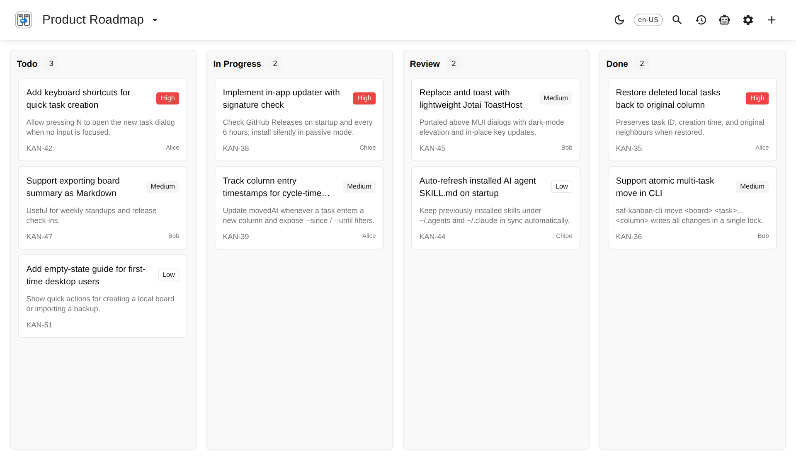

# <picture><source media="(prefers-color-scheme: dark)" srcset="design/icons/kanban-drag-frame-soft-dark.svg"></picture> SAF Kanban

繁體中文 | [English](README.en.md)

**不用自架伺服器、資料完全掌握在自己手裡的個人看板。**
可以直接在瀏覽器使用（資料存在你自己的 Google Sheet），也可以安裝 Windows 桌面版（資料存成電腦本機檔案，並支援 AI Agent 透過 Skill / CLI / MCP 直接操作）。

**[線上開啟 SAF Kanban](https://whlshy.github.io/SAF_Kanban/)** ｜ **[下載 Windows 桌面版](https://github.com/whlshy/SAF_Kanban/releases)** ｜ **[版本紀錄](CHANGELOG.md)**

<p align="center">
  <picture>
    <source media="(prefers-color-scheme: dark)" srcset="docs/preview-dark.png">
    
  </picture>
</p>

## 目錄

- [該用網頁版還是桌面版？](#該用網頁版還是桌面版)
- [主要功能](#主要功能)
- [快速開始（Google Sheet 網頁版）](#快速開始google-sheet-網頁版)
- [桌面版（Windows）](#桌面版windows)
- [進階用法](#進階用法)
- [更新 Apps Script](#更新-apps-script)
- [常見問題](#常見問題)
- [資料與隱私](#資料與隱私)
- [開發](#開發)

---

## 該用網頁版還是桌面版？

| 比較項目 | 網頁版（Google Sheet） | Windows 桌面版 |
| --- | --- | --- |
| 資料存放 | 你自己的 Google Sheet | 電腦本機 JSON 檔案（也同時支援連 Google Sheet） |
| 需要安裝嗎 | 不用，開網頁即可（也可安裝成 PWA） | 下載單一安裝檔，免系統管理員權限 |
| 離線使用 | 可唯讀檢視上次載入內容 | 本機看板**完全離線讀寫** |
| AI Agent 整合 | — | 支援 Claude Code、Codex、Gemini CLI、Cursor 等（Skill / CLI / MCP / HTTP API） |
| 刪除復原 | 從歷史紀錄重新建立 | 本機看板可直接**原樣復原**到原欄位與原位置 |
| 更新方式 | 網站更新後自動提示重新整理 | 0.5.0 起支援 **App 內一鍵檢查、驗證並安裝更新** |

---

## 主要功能

- **看板與任務管理**
  - 新增、編輯、刪除 Task，設定 Priority、Assignee 與 Issue 連結（Jira、GitHub Issues 等）
  - 自訂欄位不限數量，支援同欄與跨欄拖曳排序（手機上長按拖曳，直式單欄左右滑動）
  - 自動記錄任務建立時間（`createdAt`）與最後移入目前欄位的時間（`movedAt`），停駐提示框、描述與編輯視窗皆可查看
  - 即時搜尋與篩選（關鍵字、負責人、優先順序），篩選狀態下仍可拖曳排序
- **多看板、備份與歷史紀錄**
  - 同時管理多個看板，網址帶 `?board=<ID>` 可加書籤或多分頁並開
  - 一鍵匯出／匯入設定檔，並支援瀏覽器端 **AES-GCM 密碼加密**（PBKDF2-SHA256）
  - 刪除的任務保留於歷史紀錄，支援搜尋、重新建立（桌面版支援直接原樣復原）
- **跨裝置與桌面體驗**
  - 繁體中文 / English 切換、淺色 / 深色主題
  - 可安裝成 PWA 應用程式，離線可開啟檢視上次內容
  - Windows 桌面版支援系統匣常駐、開機自動啟動、App 內自動更新與 AI Agent 整合

---

## 快速開始（Google Sheet 網頁版）

用範本建立最快，不需手動建工作表或貼程式碼：

1. 開啟 [SAF Kanban 範本](https://docs.google.com/spreadsheets/d/1-gsXi8JZQrIwAiK6q2koaPp0resipV-G_0YFYOja7yc/copy)，按「**建立副本**」存到自己的 Google 雲端硬碟（已內含工作表與 Apps Script）。
2. 在副本右上角點「**共用**」，將「一般存取權」設為「**知道連結的任何人 → 檢視者**」。
3. 點上方選單「**擴充功能 → Apps Script**」，部署成網頁應用程式：
   - 點「**部署 → 新增部署作業**」→ 類型選「**網頁應用程式**」
   - 執行身分選「**我**」、存取權限選「**所有人**」→ 按「**部署**」並完成授權
   - 複製產生的網址（`https://script.google.com/macros/s/.../exec`）
4. 開啟 [SAF Kanban](https://whlshy.github.io/SAF_Kanban/)，點畫面中間的「**設定**」（或左上角選單「新增看板」），直接貼上 **Sheet 網址** 與 **部署網址**，按「**建立**」即可使用。

> 網址會自動擷取成對應的 ID，不需要自己手動切字串。設定保存在目前瀏覽器的 Local Storage，建議設定好後先試著新增、拖曳與刪除一張測試卡確認讀寫正常。

<details>
<summary><strong>想自己從頭建立（或查看 Google Sheet 四張工作表的欄位規格）</strong></summary>

### 1. 建立四張工作表

新建一份 Google Sheet，建立以下四張工作表（名稱大小寫必須完全一致，**不要加標題列，資料直接從第 1 列開始**）：

- `kanban`：儲存任務，欄位固定為 `A:I`（可先留空）

| 欄位 | 內容 | 範例 |
| --- | --- | --- |
| A | Task ID（系統自動產生） | `4836540b` |
| B | Title | `Implement login page` |
| C | Issue ID | `PROJECT-101` |
| D | Description | `Create login form` |
| E | Kanban Column（須與 `columns` A 欄完全一致） | `Todo` |
| F | Priority | `high`、`medium`、`low` |
| G | Assignee | `王小明` |
| H | 建立時間（Apps Script v3 起自動填入） | `2026-11-21 10:30:00` |
| I | 移至此欄時間（Apps Script v4 起自動填入，跨欄時更新） | `2026-11-24 14:20:00` |

- `columns`：A 欄依序填寫看板欄位名稱（例如 `Todo`、`In Progress`、`Testing`、`Done`），數量不限。
- `users`：A 欄填寫可指派的負責人名稱（相容舊格式：若 B 欄有值會改取 B 欄）。
- `history`：保留已刪除的任務（沒建時第一次刪除會自動建立）。A～G 欄同 `kanban`，H 欄為刪除時間，I 欄為建立時間，J 欄為移至此欄時間（v4 起）。

### 2. 開放讀取權限並貼上 Apps Script

1. 將 Sheet 設為「**共用 → 知道連結的任何人 → 檢視者**」（不需開放編輯，寫入由 Apps Script 負責）。
2. 開啟「**擴充功能 → Apps Script**」，刪除預設程式碼，完整貼上 [`apps-script/Code.gs`](apps-script/Code.gs) 並儲存（頂部 `SPREADSHEET_ID` 留空即可）。
3. 依照上方快速開始第 3～4 步完成部署與連接。

### 3. 設定欄位說明

| 設定 | 填入內容 |
| --- | --- |
| 看板名稱 | 顯示在左上角（可留空） |
| Sheet ID | Google Sheet 完整網址或 `SHEET_ID` |
| Apps Script 部署 ID | 部署後的網頁應用程式完整網址或 `DEPLOYMENT_ID`（不需申請 Google Cloud API Key） |
| Issue Link | Issue 基底網址，點擊任務 Issue ID 時會接在後面（例如 Jira `https://your-company.atlassian.net/browse/`、GitHub `https://github.com/OWNER/REPO/issues/`） |

> 附註：`User Name` 欄位目前保留未使用可留空；舊版名稱「Sheet API Key」「Jira Link」「Jira ID」對應新版的「Apps Script 部署 ID」「Issue Link」「Issue ID」，不影響既有資料。

</details>

---

## 桌面版（Windows）

不想依賴 Google Sheet 與網路，或想讓 AI Agent 直接管理看板，可以安裝 Windows 桌面版：

1. 到 [Releases](https://github.com/whlshy/SAF_Kanban/releases) 下載最新的 `SAF-Kanban_<版本>_x64-setup.exe` 執行安裝。
2. 安裝檔目前未加程式碼簽章，Windows 跳出「Windows 已保護您的電腦」時點「**其他資訊 → 仍要執行**」。
3. 安裝 `0.5.0` 以上版本後，未來出新版會自動偵測並可在 **App 內一鍵更新**；先前已安裝的 AI Skill 也會在啟動時自動同步為最新版。

完整的系統匣操作、AI Agent 連線（Skill / CLI / MCP）、資料備份與 HTTP API 說明，請見 **[桌面版說明（desktop/README.md）](desktop/README.md)**。

---

## 進階用法

### 多個看板
點左上角看板名稱 →「**新增看板**」，即可為不同專案建立各自獨立的看板（桌面版可混用本機看板與 Google Sheet 看板）。網址會自動帶上 `?board=<ID>`，方便加書籤或開多個分頁同時看。刪除 Google Sheet 看板只會移除瀏覽器設定，不會刪除 Sheet 本身資料。

### 匯出、匯入與密碼加密
點左上角看板名稱 →「**匯出設定**」可將勾選的看板匯出成 JSON 檔（在另一個瀏覽器選「**匯入設定**」即可還原，重複名稱會在匯入前提示改名）。
- 匯出檔內含 Apps Script 部署 ID，請勿公開分享。
- 匯出時可勾選「**用密碼加密**」（至少 8 字元，在瀏覽器內以 Web Crypto `PBKDF2-SHA256` 60 萬次 + `AES-GCM` 加密，密碼不會上傳也無法救回；需透過 HTTPS 或 `localhost` 開啟）。

### 搜尋與篩選
點右上角放大鏡開啟搜尋列，可同時依關鍵字（比對標題、描述、Issue ID、負責人，空白分隔多詞且不分大小寫）、負責人（含「未指派」）與優先順序篩選。篩選期間欄位數字會顯示 `符合數 / 總數`，且仍可直接拖曳排序。

### 已刪除的任務
點右上角時鐘圖示可瀏覽目前看板已刪除的任務（由新到舊、支援搜尋）。網頁版可點右側「重新建立」帶入原內容另建新任務；桌面版（本機看板）還提供「復原」按鈕，直接以原 ID 與建立時間放回原本欄位與位置。

### 安裝成應用程式（PWA）與離線使用
- 支援 Chrome / Edge（電腦與 Android）從左上角選單點「安裝應用程式」，以及 iOS Safari 的「分享 → 加入主畫面」。
- 離線時仍可開啟檢視上次載入的看板內容（唯讀，恢復連線後即可編輯）；網站有新版時上方會出現提示，按「重新整理」或重開所有分頁即可套用。

---

## 更新 Apps Script

[`apps-script/Code.gs`](apps-script/Code.gs) 更新後，舊版 Script 仍可相容運作，但不會有新功能（各版差異見[版本紀錄](CHANGELOG.md#apps-script-版本)）。目前最新版（v4）提供：刪除保留到 `history`、寫入前檢查是否為對應 Sheet、多語錯誤訊息、以及記錄任務建立時間（H 欄）與移入欄位時間（I 欄）。

更新步驟（部署 ID 不會改變，SAF Kanban 設定不需修改）：

1. 打開 Google Sheet 的「**擴充功能 → Apps Script**」，用 [`apps-script/Code.gs`](apps-script/Code.gs) 完整覆蓋原本程式碼並儲存。
2. 執行：**部署 → 管理部署 → 編輯（鉛筆）→ 版本：新版本 → 部署**。

---

## 常見問題

- **畫面沒有顯示欄位或 Task**：確認工作表名稱為全小寫 `columns`、`kanban`，資料從第 1 列開始（沒有標題列），且 `kanban` E 欄的值與 `columns` A 欄完全相同。
- **顯示 403 或無法讀取資料**：確認 Google Sheet 已設為「知道連結的任何人 → 檢視者」。
- **新增／移動出現 CORS 錯誤或寫入失敗**：通常是 Apps Script 未回傳正常 JSON。請用**無痕視窗**開啟部署網址 `https://script.google.com/macros/s/DEPLOYMENT_ID/exec` 驗證：
  - 看到 `{"status":"error","code":"UNKNOWN_ACTION", ...}` 表示部署正常，請檢查設定裡的部署 ID 與 Script 的 `SPREADSHEET_ID`（留空或填同一份 Sheet ID）。
  - 看到 Google 登入頁或「需要存取權」，表示存取權限不是「所有人」（公司 Google Workspace 帳號可能限制無法開放「所有人」，需改用個人 Google 帳號）。
- **修改 Apps Script 後沒生效，或回傳 `undefined is not valid JSON`**：只按儲存不會更新線上版本，請到 **部署 → 管理部署 → 編輯 → 版本：新版本 → 部署** 重新發佈。
- **Issue 連結無法開啟**：確認 Issue Link 結尾路徑正確（例如 Jira 結尾需有 `/browse/`，GitHub 需有 `/issues/`）。

---

## 資料與隱私

- **網頁版（Google Sheet）**：資料全部保存在你自己的 Google Sheet；因為瀏覽器需要讀取，Sheet 須設為知道連結可檢視，請勿存放密碼或機密。Apps Script 部署 ID 等同寫入權限，請妥善保管。離線快取僅存在目前裝置的瀏覽器內，清除網站資料即移除。
- **桌面版（本機看板）**：資料完全保存在你的電腦資料夾中，不會上傳到任何外部伺服器（詳見[桌面版安全說明](desktop/README.md#安全性)）。

---

## 開發

需要 Node.js 22；開發桌面版另需 Rust。

```bash
npm install
npm start            # 開發伺服器，http://localhost:1001
npm run lint         # 前端 ESLint 檢查
npm test             # 前端單元測試（Node 內建測試工具）
npm run build        # 建置網頁版到 dist/
```

桌面版程式碼在 [`desktop/`](desktop/README.md)（Rust + Tauri）：

```bash
npm run local        # 建置桌面版畫面並啟動本機伺服器
npm run test:server  # 執行 Rust 伺服器與 CLI 測試
cargo clippy --manifest-path desktop/Cargo.toml --all-targets -p saf-kanban-server -- -D warnings
npm run build:app    # 建置桌面版程式與安裝檔（正式安裝檔由 GitHub Actions 建置）
```

推送至 `main` 後，[GitHub Actions](.github/workflows/deploy.yml) 會自動執行 lint、測試、clippy、建置並發佈至 GitHub Pages（repo 的 Settings → Pages → Source 需設為「GitHub Actions」）。
